# GoT-Pampas-UE5

**在 Unreal Engine 5.8 里还原《对马岛之魂》的芒草原野：GPU 程序化草叶 + 统一风场 + 大世界 PCG**


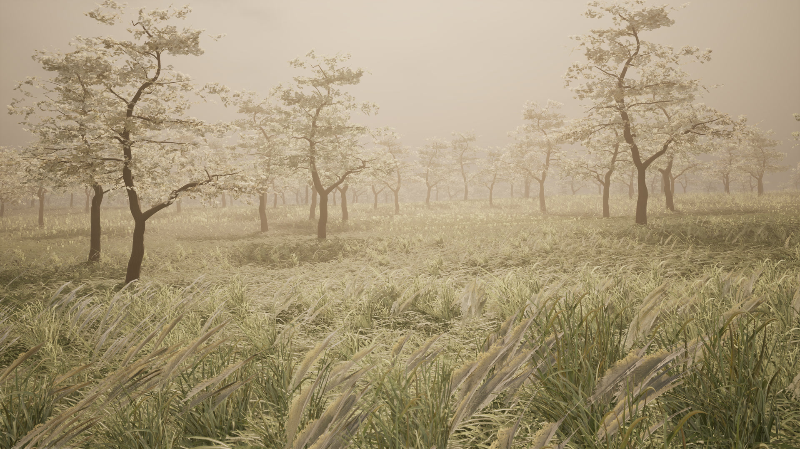
<sub>UE 5.8 编辑器内实时渲染，Epic 画质，4K 渲染后缩小到 1920 宽。下同。</sub>

> **English summary.** A personal rendering study that rebuilds the pampas fields of *Ghost of Tsushima* in UE 5.8. Grass blades are generated on the GPU every frame (quadtree tiles → compute → indirect draw → custom vertex factory). One shared HLSL wind model drives the GPU grass, the modelled pampas and trees, and a player-centred interaction field. The 1 km map streams through World Partition, with about 470k PCG pampas instances, 900 Nanite maples and HLOD. The structure follows Sucker Punch's public GDC 2021 / SIGGRAPH 2021 talks and was checked against PIX frame captures. In-editor PIE runs at about 14.6 ms per frame at 1080p High on an RTX 5060. No game assets, captures or disassembled game code are included in this repository.

## 项目概览

这是一个个人渲染研究项目，目标是把《对马岛之魂》开场那种被风吹动的芒草原野，做成能在 UE 里自由走动的场景。

- **范围**：只做环境渲染，包括地形、植被、风、天空和雾。不做角色、动画和 UI；试玩用 UE 的第三人称模板角色。
- **依据**：以官方公开资料确定系统结构，包括 GDC 2021 的风场和程序化草地两场演讲、SIGGRAPH 2021 的光照与大气讲座。再用 PIX 截帧核对常量和数据布局。研究笔记里每条结论都标了来源级别（见[研究方法](#研究方法)）。
- **原则**：先看画面，再看技术。允许用不同的实现达到相同的画面，但所有动态元素必须说清楚风和交互数据从哪里来。

### 项目亮点

| | |
|---|---|
| **GPU 草叶** | 每帧、每个视图在 GPU 上重新生成。出生点视角一帧约 **14.6 万片**（近层 15 顶点、远层 7 顶点），生成耗时 **0.22 ms** |
| **统一风场** | 阵风公式只写在一个 HLSL 文件里，由 compute shader、草叶 Vertex Factory 和材质 Custom 节点共同 include；CPU 侧按同一公式和同一张表实现镜像 |
| **交互场** | 以玩家为中心 100 m、256² RGBA16F：轨迹点按阻尼波回弹，vorticle 局部风叠加在全局风上，每帧一次 compute pass |
| **大世界** | 约 1 km 见方的地形分成 16 个 Landscape 流式分块；PCG 铺设 **46.96 万**芒草实例和 **900** 棵 Nanite 枫树，远处由 11 个 HLOD 接管 |
| **性能** | 1920×1080 / High，RTX 5060，编辑器 PIE 平均 **14.56 ms（68.7 FPS）**，p95 为 15.61 ms |

## 效果展示

**风**：同一份阵风同时驱动草叶的弯曲和芒草的整株倾斜。

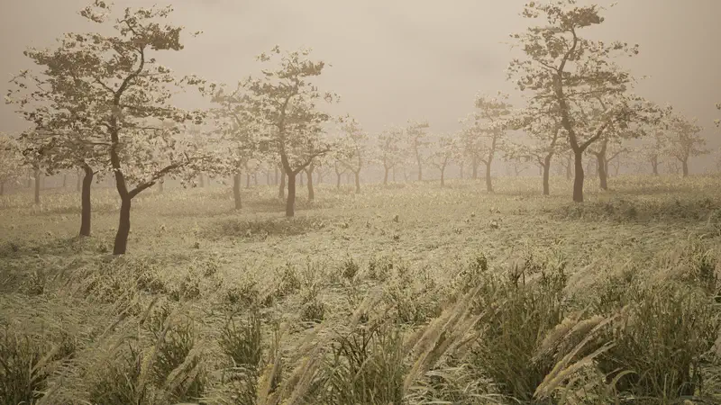

<sub>编辑器实时画面。录制时风场时钟临时放慢到 0.2 倍，帧率提上来以后再按真实速度回放。</sub>

<table>
<tr>
<td width="50%">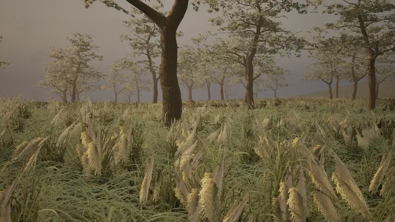</td>
<td width="50%">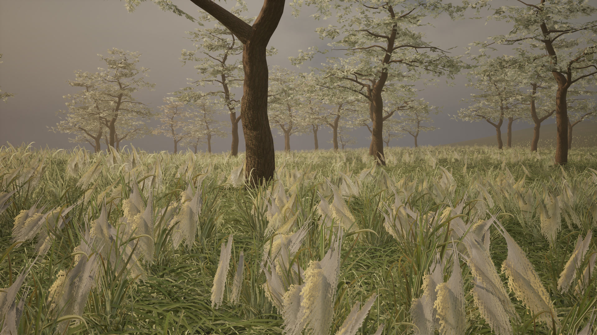</td>
</tr>
<tr>
<td>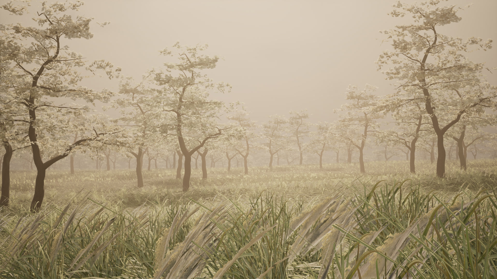</td>
<td>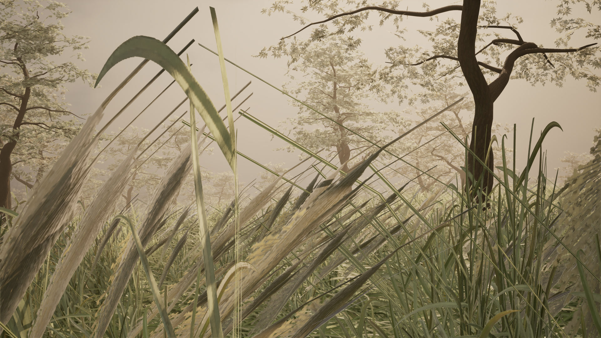</td>
</tr>
<tr>
<td>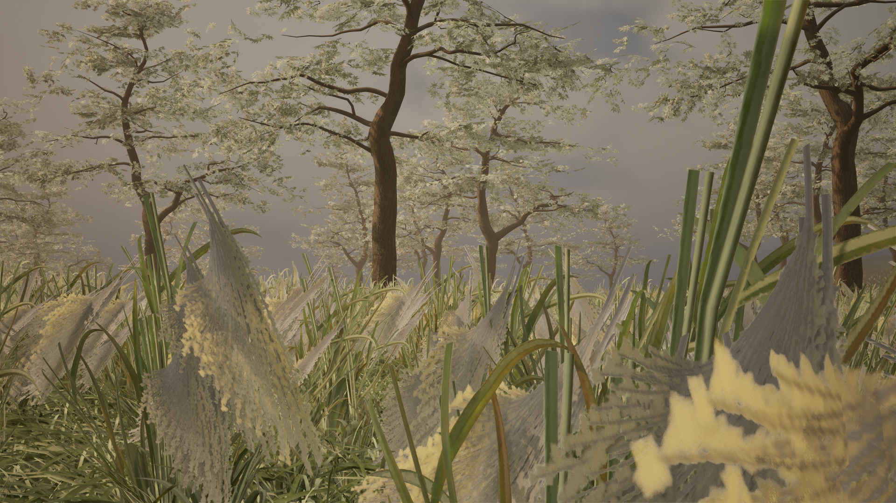</td>
<td>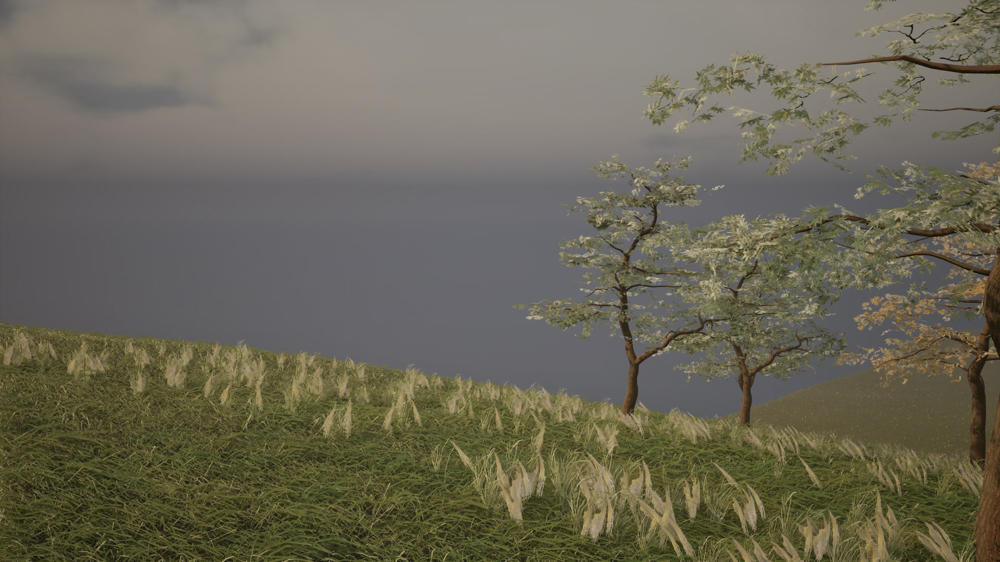</td>
</tr>
</table>

**全图鸟瞰**：地图约 1 km 见方，四周是海。枫树由 PCG 在 5×5 个分块里均匀撒点，再过滤掉陡坡。

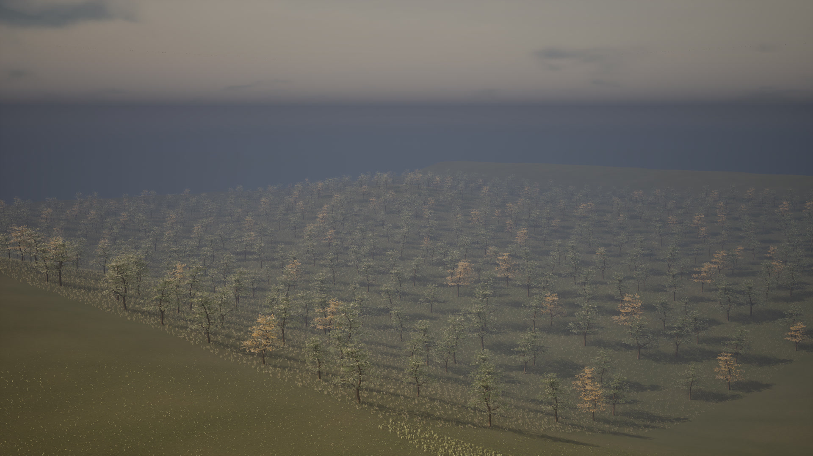

**风场调试视图**：风本身看不见，所以热力图是调风的主要手段。下面两段动图是同一机位下的两种模式：左边是主阵风噪声，阵风团顺风移动；右边是草叶的直立程度。

<table>
<tr>
<td width="50%">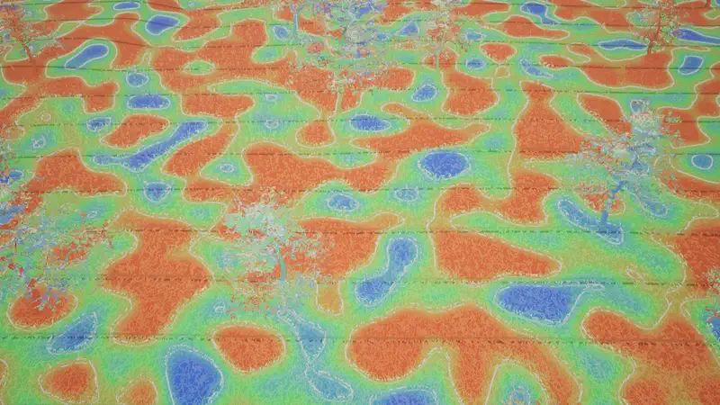<br><sub>GustNoise：主阵风强度，蓝 → 绿 → 红</sub></td>
<td width="50%">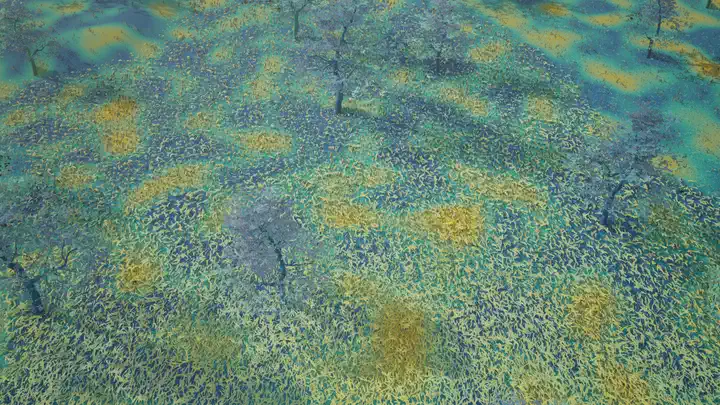<br><sub>BladeResponse：草叶离地高度（暖色直立，冷色压平）</sub></td>
</tr>
<tr>
<td>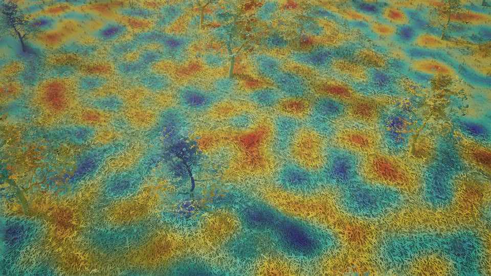<br><sub>DetailNoise：细节层的有符号强度</sub></td>
<td>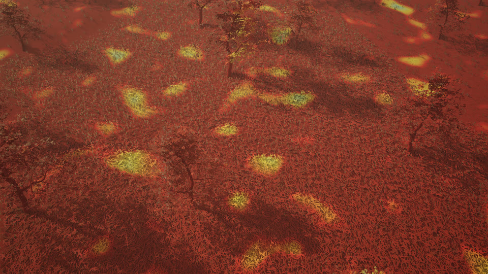<br><sub>CombinedWind：主层、细节层和局部风相加后的净风速</sub></td>
</tr>
</table>

## 系统架构

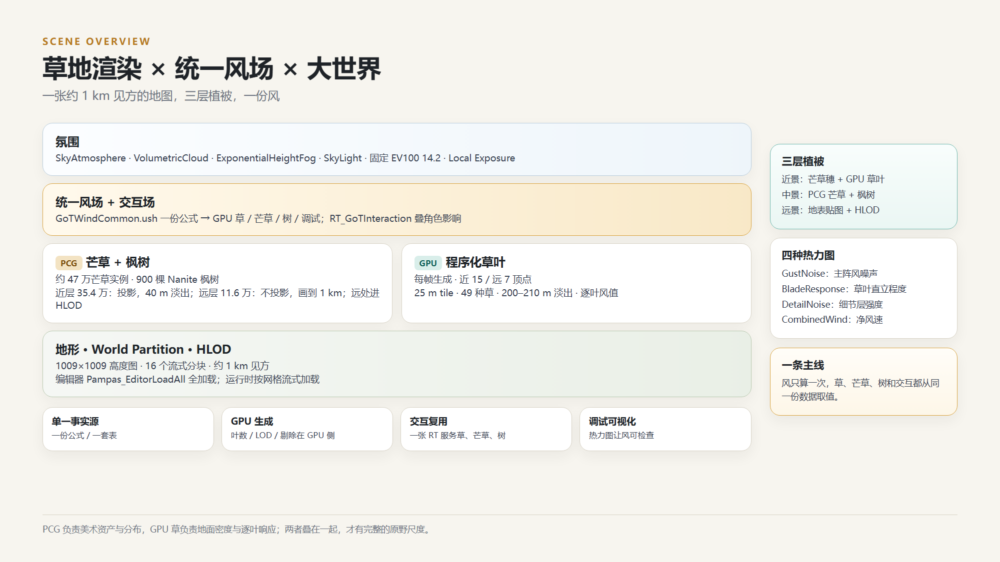

| 模块 | 位置 | 职责 |
|---|---|---|
| `AGoTWindController` | `Plugins/GoTEnvironment/Source/.../GoTWindController.h` | 关卡里唯一的风参数入口，编辑器和 PIE 中都能实时调；同时承载调试开关 |
| `UGoTWindSubsystem` | `GoTWindSubsystem.h/.cpp` | `UTickableWorldSubsystem`，编辑器视口里也会 tick。每帧积分风状态并写入 `MPC_Wind`，把渲染线程用的风帧交给 `GoTWindRender`，发射交互轨迹点，绘制调试线 |
| `GoTWindRender` | `GoTWindRender.h/.cpp` | 每个场景一份 `FGoTWindFrame`（当前帧加上一帧），CPU 噪声镜像 `GoTWindNoise::`，以及交互场的 RDG compute pass |
| `UGoTGrassComponent` / `AGoTGrassActor` | `GoTGrassComponent.h/.cpp` | GPU 草：CPU 四叉树选 tile，场景代理收集每个视图的生成任务，提交 RDG compute，按间接参数绘制，回读叶数用于调试 |
| `FGoTGrassVertexFactory` | `GoTGrassVertexFactory.h/.cpp` + `.ush` | 不读顶点流，直接从结构化缓冲取叶片记录；支持深度、BasePass 和速度 pass |
| `GoTWindCommon.ush` | `Shaders/Private/` | 风公式、Perlin、局部风合成、哈希：整个项目唯一的一份实现 |
| `GoTWindField.usf` | `Shaders/Private/` | 交互场：轨迹点阻尼波写入 RG，vorticle 暴力求和写入 BA |
| `MPC_Wind`、`MF_GoTWind`、`MF_GoTWindDebug` | 由 `Tools/ue_grass_setup.py` 生成 | 建模植被（芒草、树）的风响应和热力图；Custom 节点 include 同一份 `GoTWindCommon.ush` |

## 关键技术实现

### 统一风场：一份数据，多个消费者

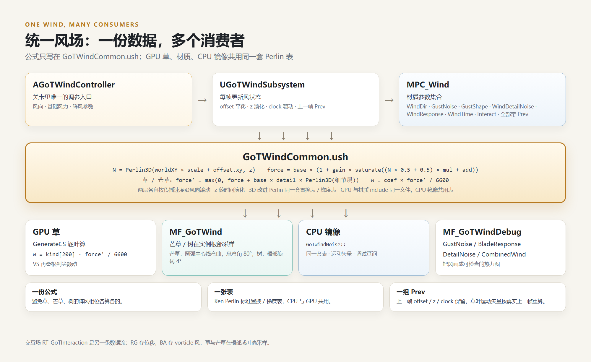

官方把风拆成四层：全局风向量、空间噪声阵风、不可见的风粒子 vorticle 和局部位移，原则是覆盖规模优先于物理精确。这里的实现是：

```hlsl
// Shaders/Private/GoTWindCommon.ush
float GoTGustForce(float2 WorldXY, float4 Noise, float4 Shape)          // Noise = (offset.xy, z, scale)
{
    const float N = GoTPerlin3D(float3(WorldXY * Noise.w + Noise.xy, Noise.z));
    const float S = saturate((N * 0.5 + 0.5) * Shape.z + Shape.w);      // Shape = (base, gain, mul, add)
    return Shape.x + Shape.x * S * Shape.y;
}

// 草和芒草再叠一层位置细节；强度为 0 时退回单层主风，树只用主风
float GoTGrassGustForce(float2 WorldXY, float4 MacroNoise, float4 MacroShape, float4 DetailNoise, float DetailStrength)
{
    const float Force = GoTGustForce(WorldXY, MacroNoise, MacroShape);
    if (DetailStrength <= 0.0) return Force;
    const float Detail = GoTPerlin3D(float3(WorldXY * DetailNoise.w + DetailNoise.xy, DetailNoise.z));
    return max(0.0, Force + MacroShape.x * DetailStrength * Detail);
}
```

- **单一事实源**：GPU 草的 compute shader、草叶 VF 和材质 Custom 节点都 include 这个文件。CPU 镜像（`GoTWindNoise::`）用同一套 Perlin 表（`GoTPerlinTables.ush` / `.inl`，Ken Perlin 标准表），供调试箭头和 `GetWindAtLocation` 查询。这样同一阵风落在草、芒草和树上时相位一致。
- **时间积分**：
  - 主层和细节层的 `offset` 各自按传播速度沿风向平移；
  - `z` 随时间增长，让阵风团边走边变形；
  - `clock` 驱动叶片颤动。
  - 这三个量的上一帧值都保留并写入 `MPC_Wind` 的 `*Prev` 参数。草叶和材质用上一帧的风状态重算一遍姿态，运动矢量对 TSR 和运动模糊是真实的。
- **当前参数**：截帧得到的默认值作为对照，关卡里是调参后的值。

| 参数 | 截帧 / 推断默认值 | 当前关卡 |
|---|---|---|
| 基础风力 | 1500 cm/s `[截帧]` | 2944 cm/s |
| 主阵风噪声频率 | 0.0004 /cm，25 m 一格 `[截帧]` | 0.002 /cm，5 m 一格 |
| 主阵风传播速度 | 1500 cm/s `[推断]` | 800 cm/s |
| 噪声形状 mul / add | 1 / 0 `[截帧]` | 2.40 / −0.5 |
| 逐叶采样抖动 | 100 cm `[截帧]` | 254 cm |
| 细节层：频率 / 强度 / 传播速度 | 无（`[适配]`，官方只提到额外的 Perlin 细节） | 0.002 /cm / 0.45 / 812 cm/s |
| 芒草：风响应系数 / 满风弯角 | — | 1.0 / 80°（圆弧弯曲） |
| 树：风响应系数 / 满风弯角 | — | 0.3 / 4°（根部旋转） |

- **局部风合成**：`GoTComposeWind` 把全局风和交互场 BA 通道里的局部风相加，返回净风速和偏转角。偏转角只用来增加弯曲，不改变草叶静止时的朝向。

### GPU 草叶：每帧重新生成一遍

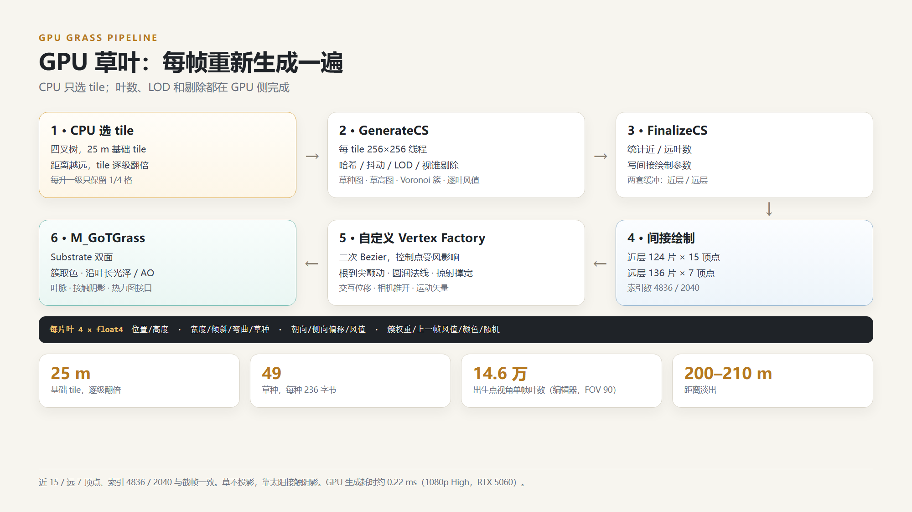

1. **CPU 选 tile**（`GoTGrassTiles::Select`）。基础 tile 为 256×256 个格子，每格 9.77 cm，即 25 m。tile 越远尺寸越大，每升一级放大一倍，在格子里隔一个取一个，同一线程数覆盖更大的面积。
2. **收集与提交**。场景代理在 `GetDynamicMeshElements` 里为每个视图登记生成任务并分配缓冲（反射捕获视图跳过）。`FGoTGrassRendererExtension` 挂在引擎的 PreRender 委托上，统一提交 RDG compute。
3. **GenerateCS**。每个 tile 256×256 个线程，大致流程：

   ```text
   cell   = tile.offset + lane * 2^level;  pos = cell * 9.77 cm + jitter(hash(cell))
   LOD    = 距离 × 0.0004；每升一级保留 1/4 的格子，200–210 m 处淡出
   视锥剔除（外扩 2 m，叶片会倾出生成点）
   kind   = 草种图上最近 4 个纹素，按双线性权重随机挑一个；为 0 或未通过密度测试就丢弃
   height = 草高图 × 草种参数；Voronoi 簇 → 簇内高宽变化、朝向、簇法线
   force  = GoTGrassGustForce(pos + 抖动, 主层, 细节层)，再加交互场的 vorticle 局部风
   wind   = kind.风系数 × force / 6600
   写入 4 × float4：位置/高度 · 宽度/倾斜/弯曲/草种 · 朝向/侧移/风值 · 簇权重/上一帧风/色档/随机
   ```
4. **FinalizeCS** 把近层和远层的计数写成两组 `DrawIndexedIndirect` 参数，CPU 不需要回读叶数。
5. **Vertex Factory**。每片叶是一条二次 Bezier：
   - 叶根固定，两个控制点由倾斜、弯曲和风值决定，再叠加一个从叶根传到叶尖的颤动正弦；
   - 交互场在叶高 12.5% 和 65% 两处做双三次采样；
   - 侧对镜头时按距离撑宽；左右边缘向外倾 0.3，得到圆润法线；
   - 近处叶片会被径向推离相机，避免糊在镜头上。
   - 近层每实例 124 片叶、每片 15 顶点，远层每实例 136 片叶、每片 7 顶点。索引缓冲按叶拆成三角形列表。
6. **材质** `M_GoTGrass`：
   - Substrate，双面；
   - 按簇的档位取色，沿叶长变化光泽和 AO，加叶脉；
   - 草不进阴影图，靠太阳的接触阴影；
   - 由于 VF 只为特定 usage flag 编译，借用了 “Used with Virtual Heightfield Mesh” 这个标志。

> 这一节的两份核心着色器（`GoTGrassGen.usf`、`GoTGrassCommon.ush`）是对照截帧转写的，**没有放进仓库**。缺失文件的接口说明见 [Shaders/Private/README.md](Plugins/GoTEnvironment/Shaders/Private/README.md)。

### 交互场与 vorticle

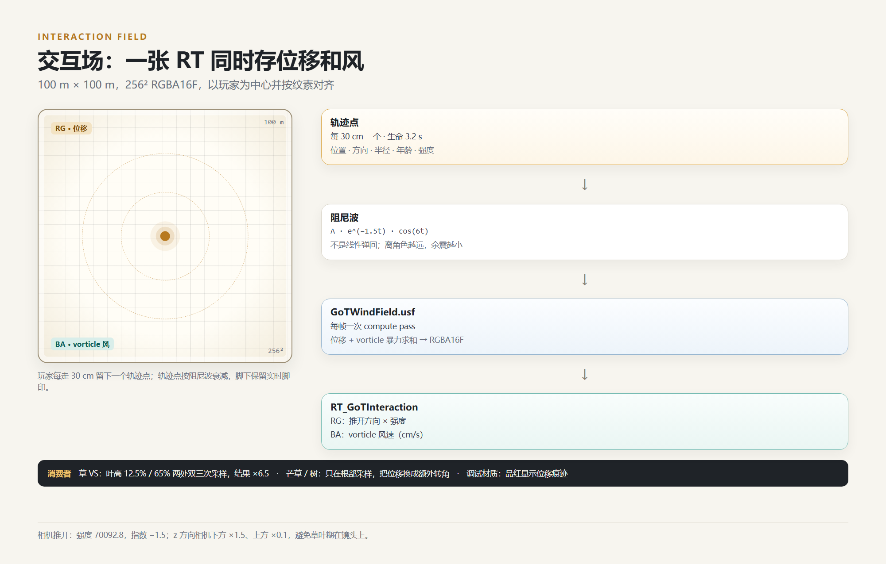

- 交互源是挂在角色上的 `UGoTWindInteractorComponent`，半径和强度可调（马这类大体型可以把半径调大）。交互源每移动 30 cm 留下一个轨迹点，轨迹点存活 3.2 s。
- `GoTWindField.usf` 每帧一次 compute pass：
  - RG 通道：轨迹点产生的推开向量，强度乘阻尼波 `e^(−1.5t)·cos(6t)`，所以草被推倒后会来回摆几下再停；
  - BA 通道：所有 vorticle 的局部风速暴力求和。
- RT 以玩家为中心、按纹素对齐，当前帧和上一帧各保留一张，供运动矢量使用。
- 消费者：
  - 草叶：VS 采样 RG（位移乘 6.5），CS 采样 BA（局部风）；
  - 芒草和树：只在根部采样一次，把位移换成额外的转角（芒草最多 50°）。

### 芒草与树的风响应

建模植被统一用 `MF_GoTWind`，在实例根部采样同一份阵风力，`w = 系数 × force / 6600`。

- 芒草：沿圆弧中心线弯曲，横截面跟着旋转，法线用变形矩阵的逆转置；满风时总弯角 80°。
- 树：按高度平方增长的根部旋转，最大 4°。
- 颤动沿用草叶的正弦形式，每个实例带随机相位。

现有网格没有原版那样的分级枢轴，所以这部分属于 `[适配]`，不是原版植被动画的复刻。

### 大世界：PCG、World Partition、HLOD

- **地形**：1009×1009 高度图，每像素 1 m，分成 16 个 `LandscapeStreamingProxy`。中央是草原台地，南侧是山脊，东侧是海崖。
- **芒草**：`PCG_PampasField` 分成 5×5 个 136 m 的分区体积，三个芒草变体都有显式 4 级 LOD（LOD0 为 450 / 602 / 298 三角）。
  - 近层：35.4 万实例，投影，22–40 m 抖动溶解淡出；
  - 远层：11.6 万实例，不投影，900–1000 m 淡出；
  - 再远由 HLOD 和地表材质接管。
- **枫树**：`PCG_PampasTrees_Uniform` 用同样的 5×5 分块。分层抖动网格撒点，向下打射线落到地形，过滤掉超过 30° 的陡坡，随机朝向和缩放，生成 900 棵 Nanite 实例，树干带碰撞。120 m 外停止 WPO 风动，避免 VSM 每帧重绘。
- **流式加载与编辑**：运行时按 World Partition 网格流式加载。编辑器里放一个带 `GoTEditorAutoLoad` 标签的 `LocationVolume`，由 `Content/Python/init_unreal.py` 在打开地图时自动加载，所以打开地图就能看到并编辑全图，不需要把 Actor 改成常驻。
- **剔除**：开启逐实例 GPU HZB 遮挡剔除（`r.InstanceCulling.OcclusionCull=1`）和 HZB 图元遮挡（`r.HZBOcclusion=1`），见 `Config/DefaultEngine.ini`。

### 调试可视化

- **热力图**：`MF_GoTWindDebug` 接在地形、芒草、树和草叶材质上，共四种模式：GustNoise、BladeResponse、DetailNoise、CombinedWind。BladeResponse 的配色参考了一段第三方 UE5 复刻视频的逐帧分析，属于 `[推断]`。
- **调试线**：风向箭头网格、阵风等值线、交互场范围和轨迹点（绿色为推开，红色为回弹）。
- **草叶调试**：tile 级别着色，屏幕上显示叶数（GPU 回读）。`stat GPU` 里可以看到 `GoTGrass` 一项的耗时。

## 性能

测试机为 Intel Core Ultra 7 265KF、NVIDIA GeForce RTX 5060、64 GB 内存，UE 5.8，Development 编辑器。按项目约定，性能以**编辑器内帧率**为准，没有做打包测试。

| 项目 | 条件 | 结果 |
|---|---|---|
| 帧时间 | PIE 浮动窗口 1920×1080，High，TSR 87% 屏幕百分比；出生点第三人称视角，连续 12 s 共 826 帧 | 平均 **14.56 ms（68.7 FPS）**，中位数 14.52 ms，p95 15.61 ms |
| GPU 草生成 | 同上，`ProfileGPU` 三次采样，GenerateCS 加 FinalizeCS | **0.22 ms** |
| 插件 GPU 资源 | `rhi.DumpResourceMemory`，名称含 GoT | 68.2 MB |
| 单帧叶数 | 编辑器视口，出生点视角，FOV 90 | 79,648（近层）+ 66,311（远层）= 145,959 |

## 研究方法

研究目录里的每条结论都标注证据级别，仓库源码注释也沿用同一套标记：

- `[官方]`：GDC、SIGGRAPH 演讲和 PlayStation 官方博客；
- `[截帧]`：PIX 截帧中观察到的着色器常量和数据布局；
- `[推断]`：基于以上证据的推测，并写明依据，例如“两帧差值 × 30 fps 得到速率”；
- `[适配]`：为了在 UE 中落地而做的自定设计，例如细节层、圆弧弯曲、簇法线。

截帧分析流程：
1. 对游戏抓 PIX 帧；
2. 按 pass 切分事件，找到草叶生成 CS 和草叶 VS；
3. 用 dxc 反汇编 DXIL，并整理成可读形式；
4. 回放 bindless 参数缓冲，得到当帧常量（tile 参数、草种表、VS 参数块）；
5. 与官方演讲的结构描述逐项对照。

截帧、解包数据和这些分析工具都只在本地研究中使用，不随仓库发布。

## 仓库结构

```text
GoT-Pampas-UE5/
├─ GhostOfTsushima_.uproject          UE 5.8 工程描述（Content 不随仓库分发）
├─ Config/                            渲染配置：Lumen、VSM、Substrate、DX12 SM6、HZB 剔除
├─ Content/Python/init_unreal.py      World Partition 地图打开时自动加载编辑区域
├─ Plugins/GoTEnvironment/            统一风场 + GPU 草叶插件（Runtime 模块，PostConfigInit 加载）
│  ├─ Source/GoTEnvironment/          C++：子系统、控制器、渲染线程风帧、草叶组件、Vertex Factory
│  └─ Shaders/Private/                HLSL：风公式、Perlin 表、交互场、草叶 VF（另有两份未公开）
├─ Tools/                             内容构建与编辑器自动化脚本，见 Tools/README.md
└─ docs/
   ├─ media/                          效果图与动图（均为 UE 内实拍）
   └─ diagrams/                       架构图与源文件 diagrams.html
```

**未公开的内容**：

- UE 的 `Content/`：其中的芒草图集和枫树网格是从游戏资源转换来的研究替代资产；
- 两份转写的草叶着色器；
- 截帧与解包数据，以及对应的分析和解包工具；
- 内部研究笔记。

因此这个仓库**用于阅读源码和了解实现，不能直接编译出可运行的工程**。C++ 部分依赖的引擎模块见 `GoTEnvironment.Build.cs`；缺少那两份着色器时，草叶的全局着色器无法编译，插件不能正常加载。

## 个人贡献

这是一个个人项目，我负责的部分包括：

- **研究**：整理官方演讲和博客；用 PIX 截帧对照草叶生成、草叶顶点着色器和风场的常量与数据布局；按证据级别记录结论。
- **引擎实现**：`GoTEnvironment` 插件（C++、HLSL、RDG），包括风场子系统、渲染线程风帧、交互场 compute、GPU 草叶的生成与间接绘制、自定义 Vertex Factory、调试可视化。
- **场景搭建**：用 Python 脚本构建地形、材质、PCG 芒草和枫树、World Partition 与 HLOD；在 Blender 里重建芒草的几何和 LOD。
- **验证**：编辑器内自动截图、PIE 性能采样、热力图与调试线。

## 已知差距与后续

- 草叶只做视锥剔除。截帧中 5 m 外的草叶会用 8 个角点做 HZB 遮挡测试，这一步还没有实现。
- 草叶像素着色是程序化近似，截帧里的光泽、叶脉、颜色贴图和透光常数还没有逐项对齐。
- 原版草叶还有关卡级的流向图和兴趣点朝向，目前没有接入。
- 芒草和树的网格没有分级枢轴：芒草用圆弧弯曲近似，树只做根部旋转；原版的树是骨骼绑定，主干和枝条分开控制。
- 交互场只在游戏世界里运行，编辑器视口里看不到交互效果。

## 参考资料

- Bill Rockenbeck, *Blowing from the West: Simulating Wind in 'Ghost of Tsushima'*, GDC 2021 · [GDC Vault](https://www.gdcvault.com/play/1027350/Blowing-from-the-West-Simulating) · [slides (PDF)](https://media.gdcvault.com/GDC+2021/Rockenbeck-Bill-Blowing+from+the+West.pdf)
- Eric Wohllaib, *Procedural Grass in 'Ghost of Tsushima'*, GDC 2021 Advanced Graphics Summit · [GDC Vault](https://gdcvault.com/play/1027033/)
- Jasmin Patry, *Real-Time Samurai Cinema: Lighting, Atmosphere, and Tonemapping in Ghost of Tsushima*, SIGGRAPH 2021 Advances in Real-Time Rendering · [course page](http://advances.realtimerendering.com/s2021/index.html)
- PlayStation Blog: [How stunning visual effects bring Ghost of Tsushima to life](https://blog.playstation.com/2021/01/12/how-stunning-visual-effects-bring-ghost-of-tsushima-to-life/) · [Crafting the world of Tsushima](https://blog.playstation.com/2020/07/09/crafting-the-world-of-tsushima/)

## 版权声明

本仓库的源代码按 [MIT License](LICENSE) 发布，仅覆盖为本项目编写的代码。

《Ghost of Tsushima》及相关商标归 Sony Interactive Entertainment 所有，游戏素材归原权利人所有。

本仓库不包含任何游戏资源、截帧文件或反汇编代码。效果图是 UE 工程的实时画面，仅作技术研究展示；画面中的芒草和枫树为研究替代资产，资产本身没有随仓库发布。
